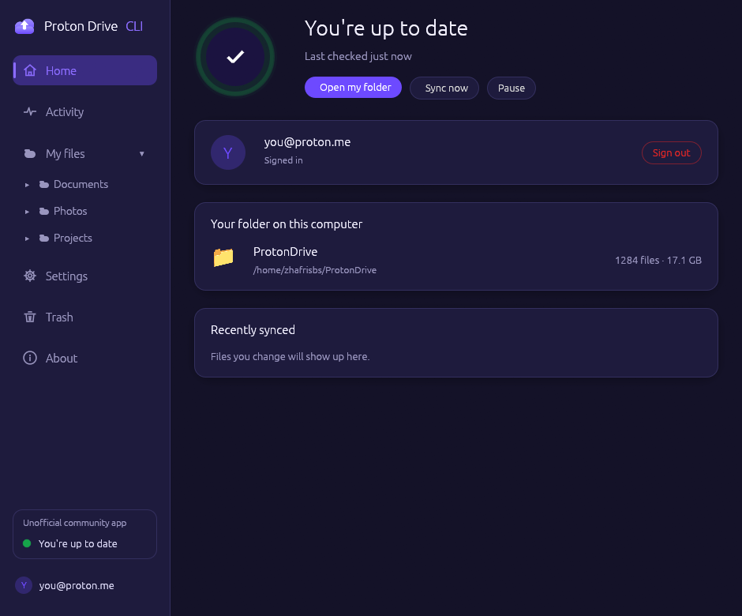
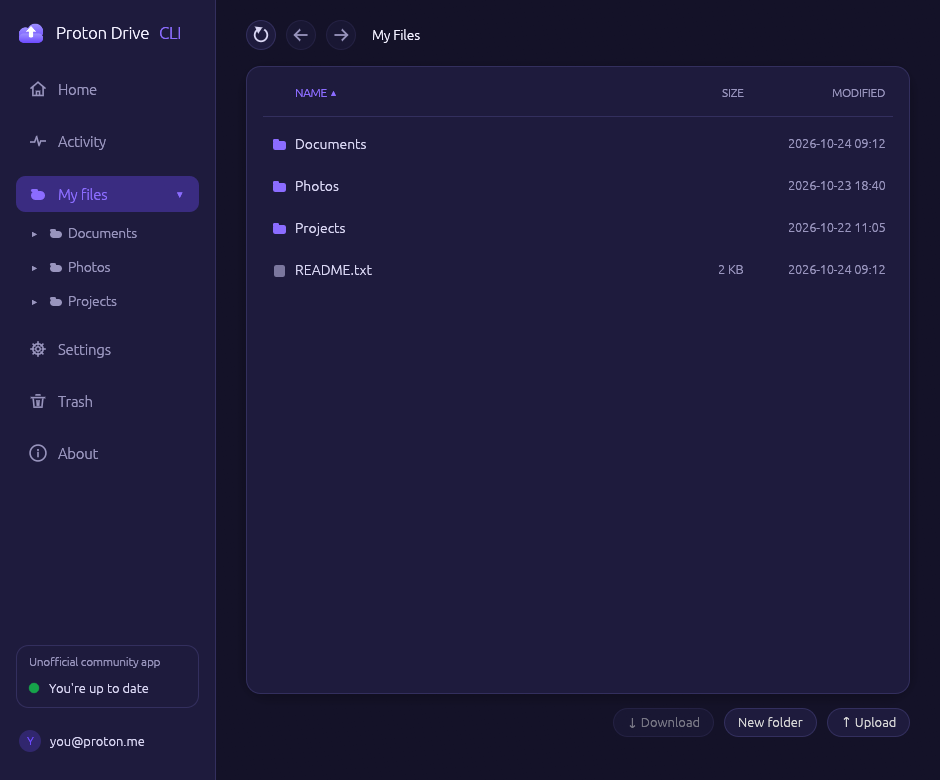
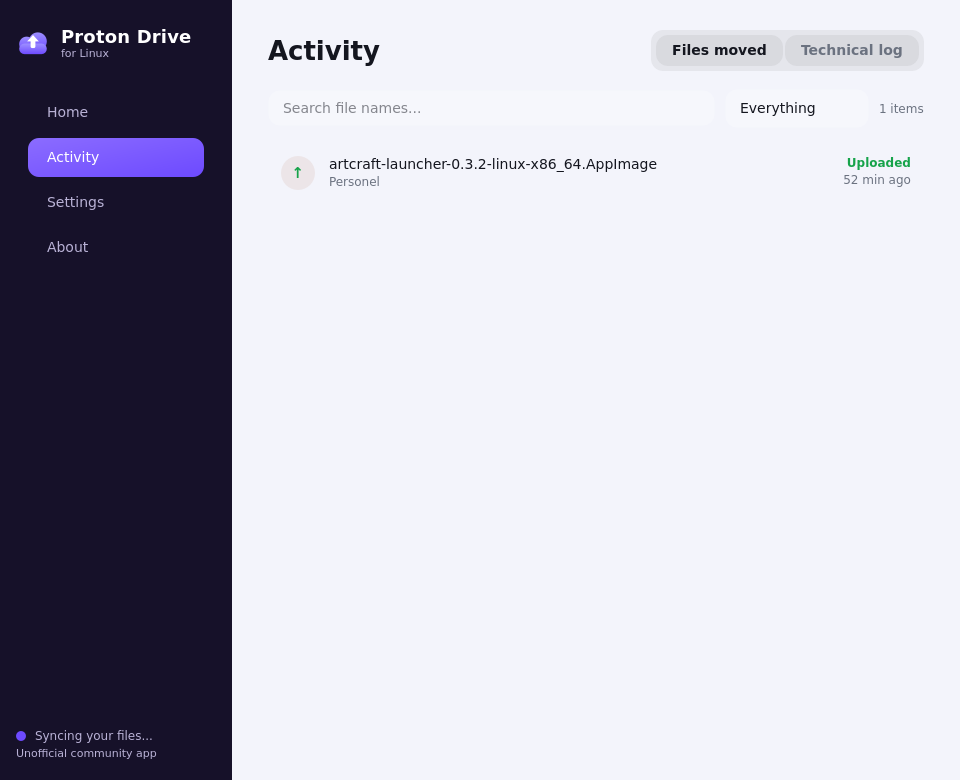
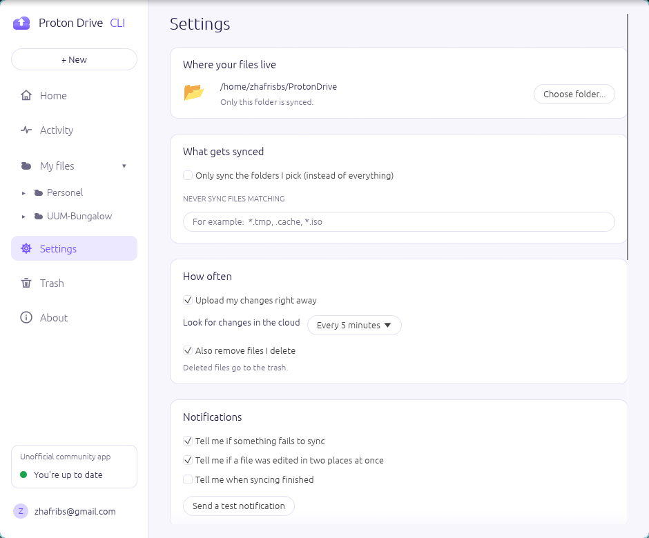

# Proton Drive — AppImage (x86_64 + aarch64)

Unofficial AppImage packaging of the **official Proton Drive CLI** published by
Proton AG at <https://proton.me/download/drive/cli/index.html>, plus an
open-source desktop app built on top of it.

Proton ships **no native Linux GUI** for Drive — only this CLI. That is what
this project packages: the unmodified upstream binary (verified against
Proton's published SHA-512 checksum before it is wrapped), the two-way folder
sync engine and the app window, in one double-clickable file.

| Artifact | Arch | Size |
| --- | --- | --- |
| `dist/ProtonDrive-CLI-0.9.0-GUI-3.12.4-x86_64.AppImage` | x86_64 (Intel/AMD) | 167 MB |
| `dist/ProtonDrive-CLI-0.9.0-GUI-3.12.4-aarch64.AppImage` | aarch64 (ARM64) | 153 MB |
| `dist/SHA256SUMS` | checksums of the outputs | |

Upstream version: **0.9.0** (released 2026-10-05), `cli-drive@0.9.0+75612299`.
Desktop app version: **3.12.4** — every release note ships the app's [development log](CHANGELOG.md).

## Quick start

**The AppImage needs nothing else installed** - it carries its own Python and
Qt6/PyQt6 desktop runtime inside. The host only needs a normal graphical
session (FUSE for AppImages and OpenGL, present on any desktop - see
[Distro notes](#distro-notes)) and a terminal emulator for the one-time
Proton sign-in.

Then download the AppImage and double-click it (or run it once from a shell):

```bash
chmod +x ProtonDrive-CLI-0.9.0-GUI-3.12.4-x86_64.AppImage
./ProtonDrive-CLI-0.9.0-GUI-3.12.4-x86_64.AppImage
```

The app opens. Click **Sign in** — Proton's official login runs once in a
terminal window (that is how their CLI does 2FA), and the app picks the
session up automatically. Choose your sync folder in Settings and save; the
first save installs the background sync service and points it at wherever
this AppImage file lives — move or upgrade the file later and the app
re-points the service by itself. From then on it lives in the tray;
*Start syncing when I log in* makes it automatic across reboots.

The upstream CLI is untouched — any argument goes straight to it:

```bash
./ProtonDrive-CLI-0.9.0-GUI-3.12.4-x86_64.AppImage --version
./ProtonDrive-CLI-0.9.0-GUI-3.12.4-x86_64.AppImage --help
./ProtonDrive-CLI-0.9.0-GUI-3.12.4-x86_64.AppImage auth login   # same login the app uses
```

Put it on your `PATH` as `proton-drive` (creates `~/.local/bin/proton-drive` → symlink):

```bash
./install-command.sh
```

Undo with `rm ~/.local/bin/proton-drive`.

Typical commands: `auth login`, `filesystem list /`, `filesystem upload <local> /`,
`filesystem download <remote> <local-folder>`, `sharing set-url ...`,
`photo timeline`, `takeout run <folder>`. Full list: `--help`.

## Folder sync (Google Drive-style)

Want your Drive as a normal folder in the file manager instead of typing
commands? The repo ships a two-way sync built **only on the official CLI** —
no AUR, no third-party binaries, nothing but this project's own MIT scripts:

```bash
./scripts/install-sync.sh     # installs a systemd *user* service (no sudo)
```

That keeps `~/ProtonDrive` in sync with the `/my-files` section of your Drive:

* **local edits upload within seconds** (inotify wakes the sync immediately),
  remote changes appear within about a minute (a cheap size-peek skips
  re-listing, bounded by `PROTON_SYNC_PEEK_AGE` so cloud deletions cannot
  hide behind the server's lagging size signal)
* **renames and moves are followed, never re-uploaded**: a file you renamed
  or moved is relocated server-side in one call (no bytes transferred) - the
  same technique rclone ships as `--track-renames`; a rename done in the web
  app or on another device is mirrored here with a plain local rename, no
  re-download
* runs at every login, restarts on failure, logs to the journal
  (`journalctl --user -u proton-sync -f`)
* dry run first: `python3 scripts/proton-sync.py --dry-run`

Safety rules baked in:

* **deletions follow you both ways, but only ever to trash** (never
  permanent; turn off with `PROTON_SYNC_DELETES=0`): a local delete goes to
  Proton's trash, a cloud delete goes to your desktop trash - both restorable
* **a sick scan can never mass-delete**: if one side comes back empty while
  the other has files (moved disk, broken login, wrong path), every deletion
  is held for that cycle and logged
* a file deleted on one side with deletion propagation off stays on the
  other - no surprise data loss
* conflicts keep **both** versions (`name (conflict <timestamp>)`), and uploads
  use `create-new-revision`, so the old version stays in Proton's history
* Proton Docs/Sheets cannot be downloaded by the CLI; they are skipped

Knobs: `PROTON_SYNC_LOCAL`, `PROTON_SYNC_REMOTE`, `PROTON_SYNC_INTERVAL`,
`PROTON_SYNC_FULL_EVERY`
(seconds, default 300), `PROTON_SYNC_DELETES`, `PROTON_SYNC_WORKERS`,
`PROTON_SYNC_RETRIES`, `PROTON_SYNC_SUBFOLDERS` (comma-separated folders to
mirror instead of everything), `PROTON_SYNC_EXCLUDE` (comma-separated globs
like `*.tmp,.cache` that are never synced), `PROTON_SYNC_INOTIFY=0` (disable
the fast path). Uninstall:
`./scripts/install-sync.sh uninstall` (folder and state are kept).
Settings live in `~/.config/proton-sync.conf` - edit by hand or with the app.

## Desktop app (GUI)

| Home | Cloud | Activity | Settings |
|:---:|:---:|:---:|:---:|
|  |  |  |  |

*The compact floating window (940x780 default, 920x540 minimum - no page ever
scrolls sideways, stays on top, size remembered) - light theme shown; dark and
system themes included.*

```bash
./scripts/install-sync.sh    # the sync service first (see above)
./scripts/install-gui.sh     # then the app: menu entry + icon + launcher
proton-drive-gui             # or search "Proton Drive" in your app menu
```

A friendly Qt6 desktop app for the sync service - **in the AppImage it uses
the Qt6/PyQt6 stack bundled inside the file** (nothing to install, no AUR);
running these repo scripts directly instead uses your distro's PyQt6 from the
**official** repositories (`python3-pyqt6` / `python3-qt6` / `python-pyqt6`).
Designed for everyday users:

* **Home** - a big friendly status ("You're up to date" / "Syncing..." /
  "Sync is paused") with an animated status orb, one-click *Open my
  folder*, *Sync now* and *Pause* (15 minutes, 1 hour, or until you
  resume), your account, folder size and recently synced files
* **Cloud** - a full file manager for your cloud drive, like browsing in a
  web browser: Back/Forward buttons and clickable breadcrumbs, sortable
  name/size/date columns (folders always on top), right-click for
  *Rename*, *Move to...* and *Move to trash* (or press Delete), new
  folders, uploads of files or whole folders, multi-select for batch
  download/move/trash, and a **Trash** view with one-click *Restore* -
  trash is never permanent. Every folder paints instantly - from the
  sync engine's scan and your browsing history (remembered between
  launches) - while fresh data loads behind it, and every view is live,
  so website changes appear the moment you open a folder
* **Activity** - what moved recently (uploaded / downloaded / removed /
  conflicts) with search and filters, plus a technical log tab
* **Settings** - plain-language options: which folder syncs, selective
  sync (browse the cloud and pick folders), never-sync patterns
  (`*.tmp`-style), instant upload, cloud check speed (as fast as every 30
  seconds), notifications with a test button, plus these sections:
  * *Running in the background* - keep this window floating above other
    windows, keep-in-tray on close, start quietly in tray, start syncing
    at login, and open the app itself at login
  * *Appearance* - light/dark/system theme
  * *Updates* - automatic GitHub release checks with a tray notice, and a
    one-click *Download and restart* when running as an AppImage (the
    download is verified against the published SHA256 checksum before it
    replaces the old file)
  * *Installing on Linux* - one click adds a menu entry + icon for the
    current user (no admin rights; works with the AppImage on Debian,
    Fedora and Arch)
  * *Advanced* - connections, retries, extra environment variables, log
    access

  Saving writes `~/.config/proton-sync.conf` and restarts syncing.

What the settings mean (the app keeps this short - the details live here):

* **Keep this window above other windows** - the app opens as a compact
  centered window floating over your other apps; its size is remembered.
  On Wayland sessions the app automatically runs its window through
  X11/XWayland, because the Wayland protocol has no keep-above request.
* **Keep running when I close the window** - the app hides to the tray
  and syncing never stops. Turn off to fully quit on close.
* **Start quietly in the tray** - launch as a small tray icon instead of
  a window.
* **Start syncing when I log in** - enables the background sync service
  at login (systemd user service).
* **Open Proton Drive when I log in** - starts the app itself at login
  via a per-user autostart entry (`~/.config/autostart/`).
* **Also remove files I delete** - deletions follow you both ways (on by
  default): a local delete goes to Proton's trash, a cloud delete goes to
  your desktop trash - nothing is ever deleted permanently, and a broken
  scan can never empty a side (deletions pause instead).
* **Updates** - checks the GitHub releases; *Download and restart* only
  appears when running as an AppImage and replaces it after verifying the
  SHA256 checksum (the old file is kept as `*.old`).
* **Installing on Linux** - writes `~/.local/share/applications/
  proton-drive.desktop` + a user icon; works with the AppImage on Debian,
  Fedora and Arch, no admin rights.
* **About** - what the app is, the good-to-know rules and the legal notes
* **tray icon** - status at a glance plus desktop notifications; closing
  the window keeps it running (right-click the tray icon to quit)

## Distro notes

The AppImage needs a normal desktop session and **glibc ≥ 2.34 on x86_64**
(Debian 12 / Ubuntu 22.04 / Fedora 36 era or newer) or **glibc ≥ 2.39 on
aarch64** (Debian 13 / Ubuntu 24.04 / Fedora 40 era or newer) - those floors
come from the bundled PyQt6/Qt6 wheels. The Proton CLI payload itself needs
only glibc ≥ 2.17, so `--help`-style CLI use stays even more portable. On
Debian/Ubuntu, Fedora, Arch/CachyOS and derivatives there is **nothing else
to install** - no python3-pyqt6, no python3-qt6, no python-pyqt6:

* **Arch / CachyOS** — works out of the box if `fuse2` is installed (this build
  was made and tested here, on CachyOS).
* **Debian / Ubuntu** — AppImages need the FUSE2 library:
  `sudo apt install libfuse2t64` (Debian 13+/Ubuntu 24.04+) or `libfuse2` (older).
* **Fedora** — `sudo dnf install fuse-libs` (provides `libfuse.so.2`).

No FUSE at all (containers, restricted systems, any distro):

```bash
APPIMAGE_EXTRACT_AND_RUN=1 ./dist/ProtonDrive-CLI-0.9.0-GUI-3.12.4-x86_64.AppImage --help
# or permanently:
./dist/ProtonDrive-CLI-0.9.0-GUI-3.12.4-x86_64.AppImage --appimage-extract
```

Desktop menu entry: install [AppImageLauncher](https://github.com/AppImageCommunity/AppImageLauncher)
or run `appimaged` — the AppImage ships a desktop file (double-click opens
the app window, no terminal involved) plus 256/512 px icons and AppStream
metadata, all of which validate cleanly.

## Rebuilding / upgrading

```bash
./scripts/check-upstream.sh   # sync upstream.lock with Proton's latest release
./build.sh                    # both architectures
./build.sh x86_64             # one architecture
```

The version and its published checksums live in **`upstream.lock`** — you never
edit numbers by hand. `check-upstream.sh` parses Proton's download page,
rewrites the lock when a new release appears (or `--dry-run` to only report,
exit 3 = update available), and `build.sh` reads it and **aborts if the SHA-512
of the downloaded binary does not match**. A corrupt or incomplete lock fails
the build with a message telling you to run `check-upstream.sh`.

`build.sh` downloads `appimagetool` and the aarch64 runtime into `tools/` on
first run, fetches the upstream binaries, verifies them, then builds and
validates.

Dependencies (all non-root, nothing is installed system-wide):

* `wget` or `curl`, `bash`, `coreutils` — likely already present
* `python3` **with pip** — only for `pip download` (fetches the PyQt6 wheels;
  pip never installs anything during the build)
* `rsvg-convert` (`pacman -S librsvg` / `apt install librsvg2-bin` / `dnf install librsvg2-tools`) — renders the icon
* `desktop-file-validate` (`desktop-file-utils`) and `appstreamcli` (`appstream`) — optional, used for validation

The desktop bundle (portable CPython + PyQt6/Qt6 wheels) is fetched by
`scripts/fetch-desktop-deps.sh`, checksum-pinned, and cached in CI alongside
`tools/` and `download/`.

No `sudo` and no `mksquashfs` needed: appimagetool ships its own squashfs builder.

## Automatic updates (future-proofing)

The repository tracks upstream on its own — `.github/workflows/release.yml`:

| Trigger | What happens |
| --- | --- |
| **schedule** (every 6 h) | Runs `check-upstream.sh`. If Proton shipped a new CLI: rewrites `upstream.lock`, commits it with `[skip ci]`, builds both AppImages, renders notes from `release-notes.md.tmpl` and **publishes a release tagged `v<cli>-gui<gui>`**. If nothing changed: validation build, no commit, no release churn. |
| **workflow_dispatch** (manual) | Same, plus a `force_rebuild` input that re-uploads assets and refreshes notes for the current CLI+GUI version. |
| **push to main** (packaging changed) | Rebuilds; a changed `GUI_VERSION` publishes the pair's **brand-new release** (existing releases are never overwritten). |
| **pull_request** | Validation only — builds and checks metadata, never commits or publishes. |

Design notes:

* **Idempotent**: the release step checks whether all three assets already
  exist and skips them, so a green run does not silently replace the AppImages
  people already downloaded (their hashes change on every rebuild).
* **One release per update**: the tag is `v<cli>-gui<gui>` — the CLI from
  `upstream.lock` plus `GUI_VERSION` from the source — so a new Proton CLI *or*
  a new app version always lands as its own release with its own filenames
  (`ProtonDrive-CLI-<cli>-GUI-<gui>-<arch>.AppImage`), and older builds stay
  downloadable.
* **Fails loudly**: if Proton restructures the page so nothing parses,
  `check-upstream.sh` exits 2 and the scheduled run turns red (GitHub emails
  you) instead of silently releasing a stale build.
* **Caching**: `tools/` and `download/` (including the fetched Python/Qt
  desktop bundle) are cached, keyed on `upstream.lock` **plus**
  `scripts/fetch-desktop-deps.sh`, so routine runs only pay for the squashfs
  build.
* **Caveat**: GitHub disables scheduled workflows after ~60 days without
  repository activity. A commit/release interaction resets that clock; if the
  badge ever says "workflow disabled", re-enable it under the Actions tab.

Adding a future platform (e.g. Proton's `linux-x64-musl` build) = add
`SHA512_LINUX_X64_MUSL=…` to `upstream.lock`, map it in `APPIMAGE_ARCH` in
`build.sh`, and add it to `REQUIRED_PLATFORMS` in
`scripts/check-upstream.sh` — the checker already warns about upstream
platforms it does not package, so new ones are visible in every run log.

Local equivalent of CI: `./scripts/check-upstream.sh && ./build.sh && ./scripts/release-notes.sh`.

## Project layout

```
build.sh          reproducible build script (download -> verify -> package -> validate)
upstream.lock     VERSION + Proton's published SHA-512s - written by check-upstream.sh only
scripts/check-upstream.sh   parse proton.me, refresh upstream.lock (CI runs this)
scripts/release-notes.sh    render release-notes.md.tmpl for the built artifacts
scripts/proton-sync.py      two-way folder sync on top of the official CLI (stdlib only)
scripts/install-sync.sh     install/uninstall the sync as a systemd user service
scripts/proton-sync-gui.py  Qt6 desktop app (dashboard, logs, settings, tray)
scripts/install-gui.sh      install the app: launcher + menu entry + icon
scripts/fetch-desktop-deps.sh  fetch the bundled portable Python + PyQt6/Qt6 wheels (pinned + checksummed)
release-notes.md.tmpl       release notes template (hashes filled in at build time)
.github/workflows/release.yml  scheduled upstream check + build + publish
install-command.sh  symlink the built AppImage into ~/.local/bin
LICENSE           MIT, this project's own scripts
THIRD_PARTY_NOTICES.md  Proton's MIT payload license, trademarks, tooling credits
src/AppRun        AppImage entry point (pure argv pass-through)
src/io.github.zhafrisbs.ProtonDriveCLI.desktop     desktop entry
src/io.github.zhafrisbs.ProtonDriveCLI.appdata.xml AppStream metadata
src/licenses/Proton-Drive-SDK-MIT.txt  Proton's MIT notice (also inside every AppImage)
src/licenses/GPL-3.0-only.txt LGPL-3.0-only.txt PSF-2.0.txt  licences of the bundled PyQt6 / Qt6 / CPython (inside every AppImage)
src/protondrive-icon.svg  Proton Drive glyph (simple-icons, CC0), tinted #6D4AFF
download/         upstream binaries (SHA-512-verified, git-ignored)
tools/            appimagetool + aarch64 runtime (auto-fetched, git-ignored)
build/            generated AppDir and validation logs (git-ignored)
dist/             final AppImages + SHA256SUMS (git-ignored, released via GitHub Releases)
```

Component id / file names share the id `io.github.zhafrisbs.ProtonDriveCLI`
because appimagetool requires the metainfo file to be named
`<desktop-basename>.appdata.xml` and appstreamcli requires that basename to
equal the component id. Change the string in `build.sh` (`DESKTOP_ID`,
`METAINFO_ID`), `src/*.desktop` and `src/*.appdata.xml` if you want your own id.

## License and legal

**Your safety rules, in short: source links + disclaimers + shipped notices.**

* **This repository's scripts** (`build.sh`, `install-command.sh`, `src/AppRun`,
  the desktop/AppStream metadata, the icon file) are **MIT** — see
  [`LICENSE`](LICENSE).
* **The bundled desktop stack** (portable CPython, Qt6 libraries, PyQt6 and
  PyQt6-sip wheels, all fetched by `scripts/fetch-desktop-deps.sh` and shipped
  inside release AppImages at `usr/lib/bundled-python/`) keeps its own
  licences: CPython **PSF-2.0**, Qt6 **LGPL-3.0-only** (with Qt's FOSS
  exception), PyQt6 and PyQt6-sip **GPL-3.0-only**. All three texts ship
  inside every AppImage at `usr/share/licenses/` — LGPL and PSF accompany
  their binaries as those licences require, and because PyQt6 is copyleft
  **the AppImage as a whole is distributed under GPL-3.0-only** (this
  project's own code stays MIT; the packaged combination does not). Its
  complete corresponding source is this public repository: the build recipe,
  `src/AppRun`, the GUI and sync engine, plus the pinned third-party versions
  above. Inventory: [`THIRD_PARTY_NOTICES.md`](THIRD_PARTY_NOTICES.md).
* **The payload** (the Proton Drive CLI binary inside each AppImage) is owned by
  Proton AG and is **MIT, `Copyright (c) 2025-2026 Proton AG`**. Its source is
  the SDK Proton publishes at <https://github.com/ProtonDriveApps/sdk>, which
  Proton states the CLI is built on. MIT's condition — keep the copyright and
  permission notice with all copies — is satisfied by
  [`src/licenses/Proton-Drive-SDK-MIT.txt`](src/licenses/Proton-Drive-SDK-MIT.txt),
  which `build.sh` installs into every AppImage at
  `usr/share/licenses/proton-drive/LICENSE`. Full inventory:
  [`THIRD_PARTY_NOTICES.md`](THIRD_PARTY_NOTICES.md).
* **Binary integrity**: payloads are byte-identical to Proton's downloads
  (`build.sh` aborts on SHA-512 mismatch) — nothing is patched, repacked or
  re-signed. x64 `3533025b…`, arm64 `c8d5a6b1…`.
* **No binaries in git**: `.gitignore` excludes `download/`, `dist/`, `tools/`
  and `build/`, so this repository contains no Proton code — only a script that
  fetches it from `proton.me` at build time.
* **Trademarks**: "Proton", "Proton Drive" and the Proton logo are trademarks of
  Proton AG, and their Terms of Service grant no trademark license. The name is
  used only to identify the product being packaged (nominative use), the glyph
  comes from simple-icons (CC0 file), and **this project is unofficial: not
  affiliated with, endorsed, sponsored or supported by Proton AG**. This
  disclaimer also appears in the AppStream metadata, the desktop entry comment
  and the release notes.
* Not legal advice — I am not a lawyer. If you want zero exposure, run
  `./build.sh` yourself instead of downloading anyone's AppImage; the script
  takes binaries straight from Proton.

## The GUI question

**Short answer for daily use: the folder sync** (see
[Folder sync](#folder-sync-google-drive-style) above) gives you a `~/ProtonDrive`
folder in Dolphin/Nautilus — drag & drop, double-click to open, just like a
local drive — on top of the official CLI only.

Proton ships **no Linux desktop app** — only this CLI. For a Linux GUI, **no
reverse engineering is needed**: Proton publishes the sources of its clients at
<https://github.com/ProtonDriveApps> — `windows-drive` (C#, GPLv3),
`mac-drive` (Swift, GPLv3), `android-drive` (Kotlin, GPLv3), plus the MIT
`sdk` (TypeScript) this CLI is built on. There is no Linux client repo, so a
Linux GUI means porting `windows-drive`/`sdk` yourself. REA
(`npx rea-agents setup`) is only useful for studying runtime behaviour you
cannot read in source.
